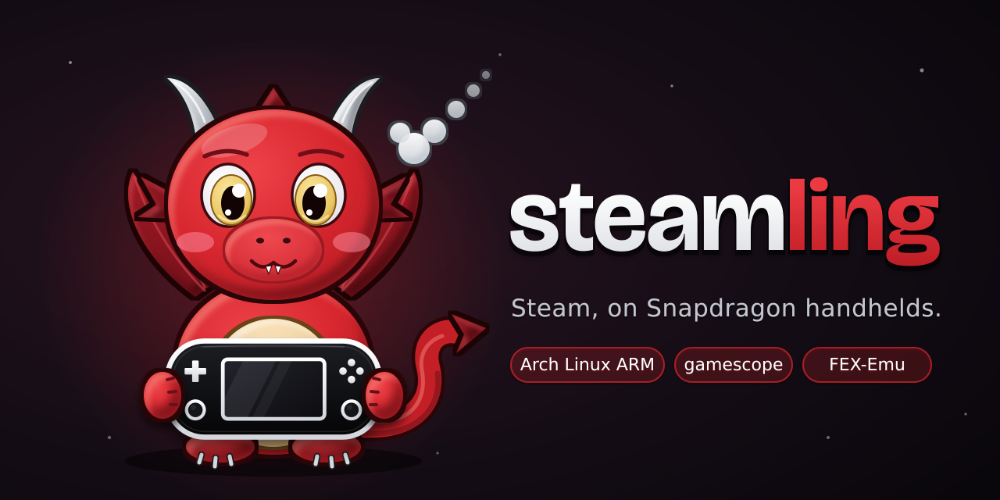

  

<h3 align="center">A SteamOS-style gaming system for Snapdragon handhelds, built on Arch Linux ARM</h3>

Turn it on, land in Steam, pick a game and play.

  

  <a href="docs/install.md"><b>Install</b></a> ·
  <a href="docs/building/README.md"><b>Build it yourself</b></a> ·
  <a href="docs/README.md"><b>Docs</b></a> ·
  <a href="docs/about.md"><b>About and thanks</b></a>

> [!WARNING]
> Steamling is new and experimental. It can break, and installing it means replacing your
> handheld's bootloader. Go in with that in mind.

## What it is

Steamling is my attempt at a SteamOS that feels at home on an ARM handheld. You boot straight into
Steam's gaming mode, Proton is picked for you, and Windows games run through FEX. Underneath it's
a normal Arch Linux ARM system, so you can drop into a desktop, install Flatpaks from Discover, or
open a terminal and do whatever you like.

- **Steam gaming mode** on the ARM Steam client, the same interface as a Steam Deck.
- **Tuned out of the box.** It ships its own kernel (based on ROCKNIX's), and the scheduler, fan
  curve and graphics drivers are set up for smooth frame times. Set a frame cap and play.
- **Steamling Control**, a Quick Access Menu plugin for per-game settings, fan and CPU modes,
  controller and screen calibration, stick lights, SD card formatting and file sharing.
- **Emulation** through ES-DE and a full set of emulators, if you want it.
- **A stable base.** Packages come from a frozen snapshot of Arch Linux ARM, so things don't shift
  under you. If you'd rather live on the edge, you can switch to rolling Arch.

## Supported devices

| Chip | Handhelds | Status |
|---|---|---|
| Snapdragon 8 Gen 2 (SM8550) | Retroid Pocket 6 (and TOP-DPAD) | Reference device, being brought up |
| Snapdragon 8 Gen 2 (SM8550) | Retroid Pocket Nova, AYN Odin 2 / Mini / Portal, AYN Thor, AYANEO Pocket ACE / DMG / DS / EVO / S | Untested ports |
| Snapdragon 865 (SM8250) | Retroid Pocket 5, Flip 2, Mini, Mini V2, AYN Thor Lite, MANGMI Air Y Pro, MANGMI Pocket Max, AYANEO Pocket MICRO 2 | Untested ports |
| Snapdragon 8 Gen 3 (SM8650) | AYANEO Pocket S2, KONKR Pocket FIT | Untested ports |
| Snapdragon 8 Elite (SM8750) | AYN Odin 3, KONKR Pocket FIT Elite | Untested ports |

"Untested port" means the device support is in place, it builds, and it should boot (it comes
from [armada](https://github.com/armada-os/armada), where these handhelds already run), but
nobody has tried Steamling on one yet. If you own one, you can help: [Supported devices](docs/devices.md)
explains how to build for it and what to report.

## Getting started

1. **Get an image.** Build one with the [build guide](docs/building/README.md). It's written so
   you can follow it even if you've never built anything on Linux. Ready-made images will go up
   on the [Releases](https://github.com/dvandenburgh/steamling/releases) page once there are some.
2. **Install it** by following the [install guide](docs/install.md).
3. **Play.** Launch a game, open the Quick Access Menu, go to **Performance** and set a
   **Framerate Limit**. If it still doesn't feel smooth, try the game's own vsync setting.

## Docs

- [Supported devices](docs/devices.md): the full list, and how to help test one
- [Install guide](docs/install.md): flashing, the bootloader, first boot
- [Install to internal storage](docs/install-to-internal.md): faster loading, uninstalling, going back to stock
- [Steamling Control](docs/steamling-control.md): the Quick Access Menu plugin
- [Emulation](docs/emulation-setup.md): ES-DE, ROMs and BIOS files
- [Android apps](docs/waydroid.md): Waydroid
- [Snapshots and rollback](docs/snapshots.md): getting back from a bad update
- [Known issues](docs/known-issues.md)
- [Building Steamling](docs/building/README.md) and [contributing](CONTRIBUTING.md)
- [About Steamling](docs/about.md): where it came from, and the people it's built on

## Thanks

Steamling stands on a lot of other people's work. It started life as a fork of
[Pocknix](https://github.com/shuuri-labs/pocknix-os) by shuuri-labs, its kernel and device
support come from [ROCKNIX](https://github.com/ROCKNIX/distribution), and much of the handheld
polish, and the support for every handheld besides the RP6, comes from
[armada](https://github.com/armada-os/armada). The full list, with my thanks,
is in [About Steamling](docs/about.md).

## License

[GPL-2.0-or-later](LICENSE.md). Third-party parts keep their own licenses; see
[docs/licensing.md](docs/licensing.md).
