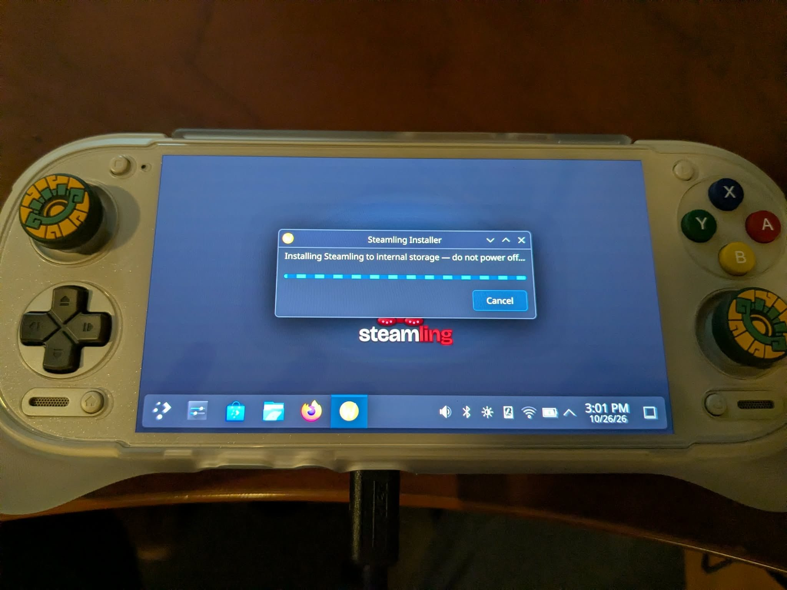
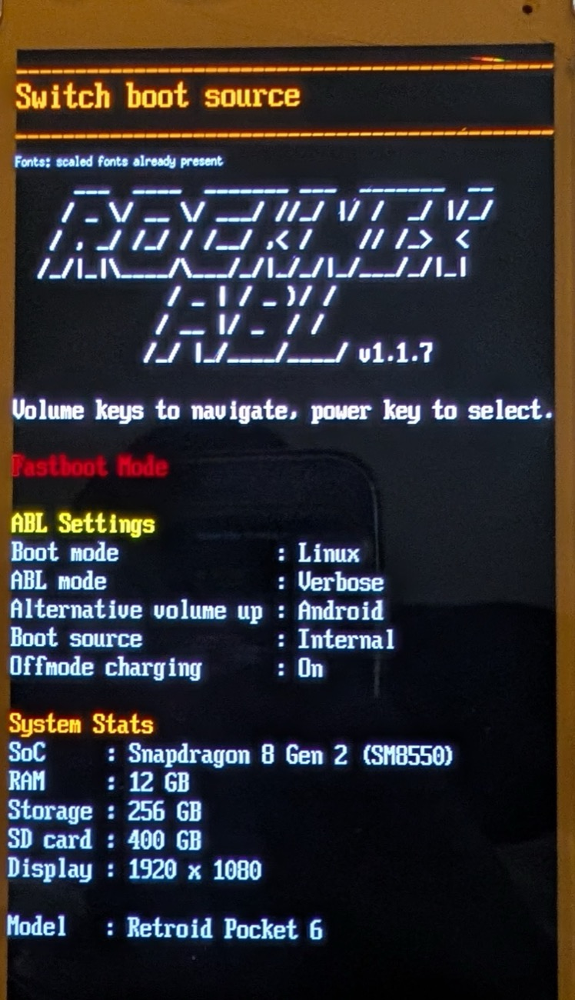

# Install Steamling to internal storage (and uninstall)

> **Install OpenABL first** if you have not already: see the [install guide](install.md).
> Steamling needs it to boot, and it is what makes switching between the internal install and the
> SD card a menu choice.

## The boot menu

Everything below uses the bootloader menu, so here's how it works first. **Hold Volume −**
while powering on to open it. **Volume keys move through the entries** and the **power key
selects**. The settings that matter here:

- **Boot mode** - what boots by default: **Linux** or **Android**.
- **Boot source** - which disk Linux boots from: **Auto** (internal storage first), **Internal**,
  **SD card** or **USB**.
- **Volume up at boot** - what holding **Volume +** at power-on boots instead, without changing
  the default (usually **Android**).

Two entries do the work in this guide: **Boot source** and **Uninstall CFW**.

These menus are OpenABL's. If your device still has the older ROCKNIX ABL, the names are a little
different (**Switch boot source** instead of **Boot source**). To move to OpenABL, use **Steamling
Tools → Bootloader: install or update to …**, or `steamling-update-abl` in a terminal.

---

## Install to internal

> ⚠️ Installing to internal shrinks Android's userdata partition, so Android reformats it on its
> next boot. Android still boots, but its apps and data are gone - effectively a factory reset. Back
> up anything you care about first.

You must be **booted from a Steamling SD card**: the installer copies the system you're running
onto internal storage.

**Everything on the SD's Steamling partition has to fit on internal storage**, Steam games and ROMs
included, in the space Android does not keep. The installer checks this before touching anything
and tells you how much to free if it does not fit: uninstall games or move ROMs off the card first,
and reinstall them onto internal storage afterwards.

Desktop mode: **Steamling Tools → Install or remove internal Steamling…**, pick how much internal
storage Android keeps, and let it run. Leave the handheld plugged in and don't power it off until
the window says it's done.



Or from a terminal:

```bash
# 1. dry-run - prints the exact partition plan, makes NO changes. Review it.
steamling-install-internal --dry-run

# 2. for real. It asks how much space Android keeps (or pass --userdata-gib N), shrinks
#    Android's partition, makes room for Steamling, then copies the running system across.
#    The copy is the slow part: several minutes from a slow SD card.
steamling-install-internal
#   non-interactive equivalent:
#   steamling-install-internal --yes --userdata-gib 16
```
Flags: `--dry-run`, `--yes`/`-y`, `--userdata-gib N`, `--device /dev/sdX` (default `/dev/sda`).
The dry run prints how much the SD holds and the largest Android size that still fits it.

If an install fails part-way (the log ends in an error after "Repartitioning"), do **not** boot
internal storage: run `steamling-uninstall-internal` (or **Remove, restore Android** in Steamling
Tools) to clear the half-written install, fix the cause, and install again.

### Then point the bootloader at it

Installing does not change what boots - the device still starts from the SD card. Power off, then
hold **Volume −** to open the boot menu and set **Boot source** to **Internal**.



Switch it back to **SD card** whenever you want to boot the SD again; nothing on either disk
changes.

### Using the SD card for games afterwards

Once the handheld boots from internal storage, the Steamling card is free to become game storage.
Formatting it erases the Steamling system on it, so first:

- **Make sure internal storage boots.** Without the card, a broken internal install has nothing
  to fall back on until you flash a new card.
- **Copy your bootloader backups off the card.** `abl_a.img`, `abl_b.img` and any
  `steamling-abl-backup/` folder are your only way back to the stock bootloader. Your PC or
  Android's internal storage are both fine.

Then open **Steamling Control → Library → SD card** and press **Format SD Card**
([details](steamling-control.md#sd-card)). Steam picks the card up as a library straight away.
If you have a spare card, you can also keep the Steamling card as a rescue card and format the
spare instead.

---

## Uninstall from internal

> ⚠️ Uninstalling from internal regrows Android's userdata partition back to its original size, so
> Android reformats it on its next boot. Android still boots, but its apps and data are gone -
> effectively a factory reset. Back up anything you care about first.

### From the boot menu (recommended)

OpenABL has this built in. On a ROCKNIX ABL older than v1.1.7 there is no *Uninstall CFW* entry,
so use the SD-card path below instead.

Hold **Volume −** at power-on and select **Uninstall CFW**. It deletes the internal Linux install
and grows Android's partition back to its full size in one step - no SD card, no second boot.


### From a running Steamling SD

You **can't repartition the disk you're booted from**, so this has to run from the SD. Set **Boot
source** to **SD card** in the boot menu, boot it, then use **Steamling Tools → Install or
remove internal Steamling… → Remove, restore Android**, or a terminal:

```bash
steamling-uninstall-internal --dry-run     # review the plan
steamling-uninstall-internal
```
It removes the internal boot and `STEAMLING_ROOT` partitions and grows Android `userdata` back to fill
the disk. Flags: `--dry-run`, `--yes`/`-y`, `--device /dev/sdX` (default `/dev/sda`). It refuses to
run if `/` is on the target device, as a guard.

---

## Put a *new* version on internal (clean reinstall)

```
boot menu -> Boot source: SD card, and boot the SD carrying your new build
  -> steamling-uninstall-internal      (clears the old install so the installer sees a fresh disk)
  -> steamling-install-internal        (clones the fresh SD onto internal)
  -> boot menu -> Boot source: Internal
```

**Steamling Tools → *Install or remove internal Steamling…* → Reinstall Steamling** does the two middle
steps in one go.

---

## Restoring the stock bootloader

Removing Steamling does not put the original Android bootloader back - OpenABL stays until you
flash your backup over it. Keeping OpenABL is mostly harmless, but if you're after a *full*
return to stock then this is the final step. It needs the `abl_a.img` / `abl_b.img` backup you were
told to make (and copy off the device) when you first flashed OpenABL (or the ROCKNIX ABL before it).

Where your backup is, depending on how you flashed:

- **Android's `backup_abl.sh`** (the [install guide](install.md#2-install-the-bootloader-openabl) steps): it wrote
  `abl_a.img` + `abl_b.img` into the kit folder on Android internal storage (`openabl/`, or
  `rocknix_abl/` on cards made before October 2026) - gone if you have since
  installed to internal, so use the copy you were told to keep off the device.
- **`steamling-update-abl` / Steamling Tools**: it saved the bootloader it replaced to
  `/flash/openabl/` and, when an SD card was mounted, copied it to `steamling-abl-backup/` on that
  card. Note this is only *stock* if that run was the first time the device's bootloader was ever
  replaced.

Then, from Android:

1. **Boot Android.** If Steamling is on internal storage, remove it first (**Uninstall CFW** above) -
   otherwise Android has no room to come back. Then set the menu's **Boot mode** to
   **Android**, or hold **Volume +** at power-on.
2. Put the `openabl` folder at the root of Android's internal storage if it isn't there any more
   (copy it off a Steamling SD card, same as during install), and **copy your `abl_a.img` and
   `abl_b.img` backups into it**, next to the scripts. The file names matter: the script looks for
   exactly `abl_a.img` and `abl_b.img`, and stops without writing anything if either is missing.
3. Open **Settings → Handheld Settings → Advanced → Run Script as Root** (on Retroid handhelds;
   other brands put it elsewhere), go into that folder,
   and run **`restore_backup_abl.sh`**.
4. Reboot. The device is back on its factory bootloader and boots Android the way it shipped.

> ⚠️ Keep the device plugged in while doing ABL writes: an interrupted or wrong bootloader write
> leaves a device that needs a PC to recover.

After this, the device can no longer boot Steamling: Steamling needs OpenABL. Flash it again
([install guide](install.md#2-install-the-bootloader-openabl)) to bring it back.
