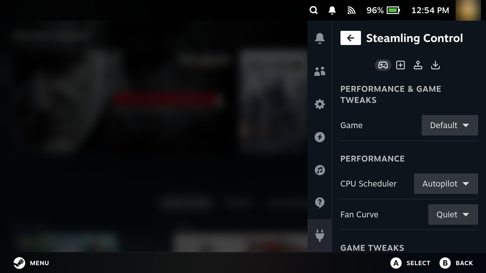
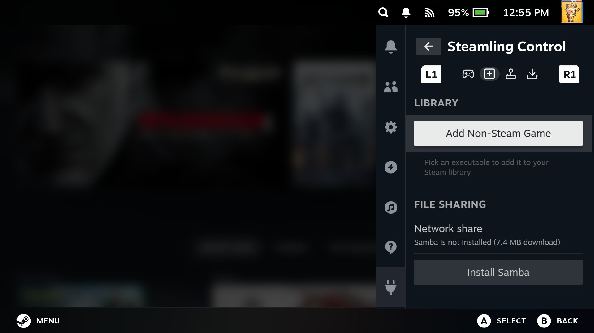
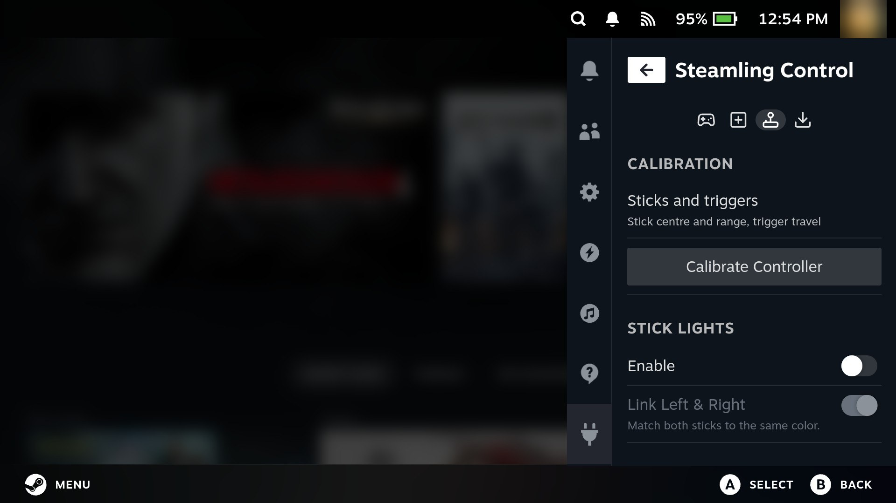
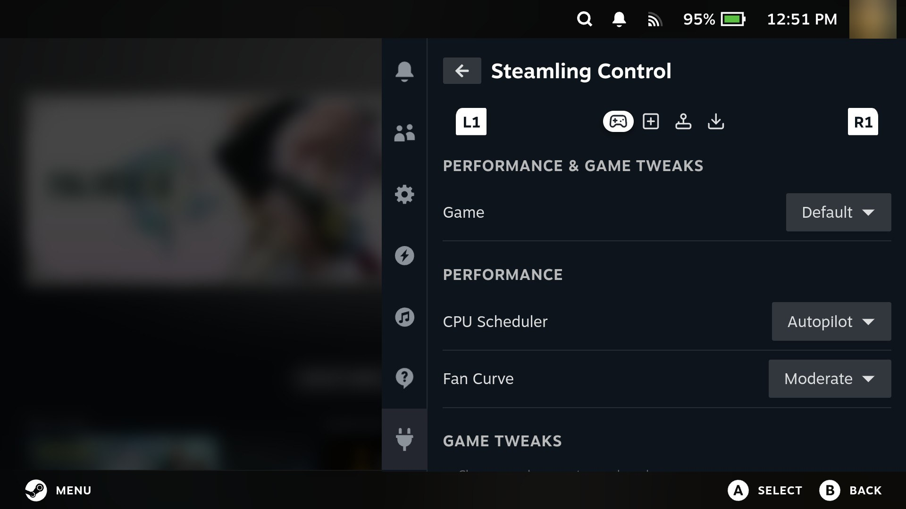
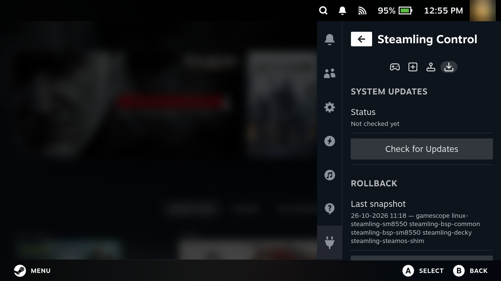

# Steamling Control

**Steamling Control** is Steamling's built-in Decky plugin: a control panel inside the Steam
session for tuning the handheld and managing the system without leaving the couch (or touching
a terminal).

Open the **Quick Access menu** in the Steam session, then pick **Steamling Control** under the
plug icon. The plugin is split into four tabs - switch between them with **L1/R1** or by
tapping the icons:

| Tab | What it does |
|---|---|
| 🎮 Games | Fan curve, CPU scheduler and game tweaks, globally or per game; suggested settings, shader cache, the performance overlay and a live system monitor |
| 📚 Library | Add non-Steam games, share your files over the network or a USB cable, turn SSH on or off, format a microSD card for Steam |
| 🕹️ Controller | Stick and trigger calibration, stick dead zone and full tilt, back paddles, rumble, stick lights, display refresh calibration, menu width |
| 🔄 Updater | Check for and install system updates, roll back the last update, see your versions, restart game mode |

Settings save automatically as you change them. The panel only shows what your handheld has:
no fan, no fan curve; a gamepad driver that can't be calibrated, no calibration; and so on.

## Games



### Game tweaks

Tweaks can be set globally (the **Default** entry in the **Game** dropdown) or per game.
Every installed Steam game is listed, and so are non-Steam shortcuts (marked `· non-Steam`).
If you open the menu while a game is running, that game is preselected. To override the
defaults for one game, select it and flip **Use Per-Game Settings** on.

Two sections follow: **Performance** (applies live) and **Game Tweaks** (applies on the
**next game launch**, except where noted). A game's settings are also reachable from its
library page: **Manage → Steamling Settings**.

**Performance**

- **Fan Curve**: **Quiet**, **Moderate**, or **Performance**. Applies live, no restart.
- **CPU Scheduler**: **Autopilot** (the `scx_lavd` default - adapts to load on the fly) or
  **Performance** (keeps the CPU aggressive at the cost of battery and heat).

Per game, either can stay on the global value.

**Game Tweaks**

- **Proton Version** (per game only): the compatibility tool Steam launches the game with,
  the same setting as the game's **Properties → Compatibility**.
- **FEX Preset**: **Default**, **Fast**, or **Compatible**. Trades x86 translation accuracy
  for speed. Try **Fast** for more FPS; switch to **Compatible** if a game misbehaves
  (crashes, glitched physics, odd audio).
- **Audio Buffer**: **Game default**, **60**, **90**, or **120 ms**. Raising the buffer
  absorbs audio crackle in busy scenes (an FEX audio-mixer quirk) at the cost of a little
  extra audio latency. 120 ms clears crackle and is inaudible in most games. Keep it low (or
  on Game default) for timing-sensitive titles - rhythm games, fighting games, anything where
  you play to the beat or need tight audio cues.
- **Disable Touchscreen**: switches the touchscreen off while the game runs, so a thumb
  resting on the screen edge cannot fire stray taps. It comes back as soon as the game exits.
  While it is off, touch is off everywhere, the Steam overlay and on-screen keyboard included;
  use the controls there. Unlike the other tweaks this one takes effect immediately, even
  mid-game, and it works for every game Steam launches, native and emulators included.
- **Controller Type** (per game only): the kind of controller the game sees while it runs:
  **Steam Deck** (the default), **Xbox 360**, **Xbox Series** or **DualSense**. This only makes a
  difference when Steam Input is turned off for the game (the game's controller settings in
  Steam), because with Steam Input on the game talks to Steam's virtual pad either way. Pick
  DualSense for a game or emulator with native PlayStation support, or an Xbox pad for one that
  can't find the controller at all. It switches when the game starts and goes back when it
  closes.
- **Mesa Version** (per game only): run the game on a different Turnip (GPU driver) build
  than the system default, when more than one is installed.
- **Disable Xalia**: on by default. Xalia is Proton's controller-navigation helper and costs
  CPU in every game; turn this off only for a game that needs it.
- **Environment Variables**: extra variables for the game's launch, the same as a Steam
  launch option.

### Sharing a game's config

With per-game settings on, the **Config** section exports the game's settings to a
`<name>.steamling.json` file, and imports one, so a tuned setup can be passed to other Steamling
users. Importing overwrites that game's settings.

### Suggested settings

When a game has known-good settings on file, picking it shows **Suggested Settings**: what they
would change, why, and which handheld they were tested on. **Use Suggested Settings** turns on
per-game settings for that game and fills them in; you can still change anything afterwards.

The list that ships with Steamling starts empty, because a suggestion should come from someone
actually playing the game on one of these handhelds. To add your own, create
`/etc/steamling/game-suggestions.json` on the handheld:

```json
{
  "games": {
    "1234560": {
      "name": "Some Game",
      "settings": { "fexProfile": "fast", "audioLatency": "90" },
      "proton": "",
      "note": "Fast preset runs it at a steady 60 with no glitches; 90 ms clears the crackle.",
      "tested": "Retroid Pocket 6, October 2026"
    }
  }
}
```

The number is the game's Steam app ID (in its store page address). `settings` takes the same
names the per-game tweaks use: `fexProfile` (`default`, `fast`, `compatible`), `audioLatency`
(`60`, `90`, `120`), `mesaVersion`, `fanMode`, `lavdMode`, `gamepadType`, `disableXalia`,
`touchDisabled` and `envVars`. `proton` is optional. If a setup works well for you, please share
it in an issue so it can go into the shipped list
(`packages/shared/steamling-decky/steamling-control/py_modules/steamling_control/game-suggestions.json`).

### Shader cache

With a game picked, **Clear Shader Cache** shows how much compiled shader data Steam keeps for it
and throws it away. That fixes some graphics glitches and odd stutter after a driver or game
update. The game builds its shaders again as it runs, so expect a little stutter the first time
through. It's greyed out while the game is running.

### Performance overlay

Shows live numbers on top of the game: **FPS only**, a **Compact bar** (FPS, CPU, GPU, RAM and
battery in one line along the top), **Detailed** (adds clock speeds, temperatures and power
draw) or **Everything**. It's the same overlay as Steam's own **Performance Overlay** setting in
the quick access menu, so changing either one changes it.

### System monitor

Turn on **Show live readings** to see what the handheld is doing while the menu is open: how busy
the CPU is and each core cluster's clock, the GPU clock, CPU, GPU and battery temperatures, the
battery level and how much power it's drawing or taking in, memory use and the fan. It reads
every 2 seconds and only while switched on and the menu is open, so it costs nothing otherwise.
For numbers on top of the game itself, use the performance overlay above.

## Library

### Adding non-Steam games



Steam's own **Add a Non-Steam Game** dialog does not work on Steamling, so add them here:

1. In the **Library** tab, press **Add Non-Steam Game**.
2. A file picker opens in your home directory. Navigate to the executable you want
   (a Linux binary, script, or Windows `.exe`) and select it.
3. Give it a name, and choose whether to **Launch with Proton**. This switches on
   automatically for `.exe` files - Windows programs need it, native Linux ones do not.
4. Press **Add to Library**. The game appears in your Steam library right away, and also
   shows up in the tweaks dropdown above so you can give it its own FEX/audio settings.

### File sharing

**Share my home folder** turns the device into a network share, so you can drag ROMs, BIOS files
and emulator firmware onto it from another computer. The first time, it offers a small download.
The same toggle is in **Steamling Tools** on the desktop side.

> **There is no password.** Anyone on the same network can read and write your home folder, so
> turn it off when you are done. See
> [copying files over the network](emulation-setup.md#copying-files-over-the-network) for how to
> connect.

### USB file transfer

**Show up on a computer** turns the USB-C port into a media device, the way a phone works: plug
the handheld into a PC or Mac and open **Steamling** to copy ROMs, BIOS files or screenshots
over the cable. Your home folder is there, and so is the microSD card when you've installed
Steamling to internal storage. No network, no drivers on Windows or Linux (a Mac needs an MTP
app such as OpenMTP).

It stays on until you turn it off or restart. While it's on, controllers, hubs and other USB
devices plugged into that port won't work.

### Remote access

**Allow SSH logins** lets you log in from another computer's terminal, and shows the exact
`ssh deck@...` line to type once it's on. It's the same switch as in **Steamling Tools**.

> Every Steamling image ships with the same default password. Change yours first: open Konsole
> in desktop mode and run `passwd`.

### SD card

Formats a microSD card so Steam can use it as game storage.

Steam's own button does the same job (**Settings → Storage**, pick the card, **Format SD Card**),
just like on a Steam Deck. This section is another way to get there, and it shows the card's
current filesystem before you wipe it.

The section shows the detected card (label, size, current filesystem); set a label if you like
and press **Format SD Card**.

> **Formatting erases everything on the card.** The confirmation dialog makes you type
> `format` before it will run, so you cannot trigger it by accident.

The card is formatted the same way a Steam Deck would (ext4 with casefolding), mounts
automatically, and gets added to Steam as a library folder - Steam offers it as an install
target right away, and cards formatted here also work in a real Steam Deck (and vice versa).

## Controller



- **Calibration**: **Calibrate Controller**, then **Start**, walks each stick and trigger to its edge and back, then
  shows live readings to check (a full push reads 100 at the edge, 0 at rest). **Save** keeps
  it across reboots, **Discard** drops it, **Reset to Defaults** returns to the driver's
  values. The controller is paused for Steam while it runs, so **Cancel** works by touch.
  Boards whose gamepad driver cannot be calibrated say so.
- **Stick Response** (boards whose gamepad driver can be calibrated): per stick, the **dead
  zone** (how far it moves before it registers, from half to three times the calibrated size)
  and **full tilt** (how far you push to reach 100%, from the edge in to 80% of the way). Raise
  the dead zone if a stick drifts; bring full tilt in if you can't quite reach the edge. They sit
  on top of the calibration, so recalibrating keeps them, and they apply everywhere, desktop
  mode included. For a response curve, use Steam Input's per-game controller settings: the
  drivers here don't do curves.
- **Back Paddles** (handhelds with back buttons): make a paddle press another button (A, B, X,
  Y, a bumper, a stick click, Select or Start) everywhere: in game mode, desktop mode and
  emulators started outside Steam. Left as **Back button** (the default), Steam sees them as
  the Steam Deck's L4/R4 and you can map them per game in Steam Input instead, which is usually
  the better choice for Steam games.
- **Rumble**: **Enable rumble** switches vibration on or off for every game, and **Strength**
  sets it to 25, 50, 75 or 100%. Each shows only on handhelds whose drivers support it (the
  Retroid Pocket 6 has both). The choice is kept across reboots.
- **Stick Lights** (boards with stick LEDs): **Enable**, **Link Left & Right** to give both
  sticks one colour, **Side Lights** to match the side lighting to the sticks, then colour and
  brightness per stick.
- **Quick Access Menu width**: **Standard** is Steam's own width; **Wide** (the default) and
  **Wider** make the whole quick access menu 100 or 200 pixels wider, Steam's own pages and other
  plugins included, so text wraps less on these small screens.

  

- **Display** (only on screens with adjustable timing, which so far means the RP6): **Calibrate Display**, then
  **Calibrate**, measures the screen's refresh rate for up to a minute and trims it onto the
  nominal rate (panels ship slightly fast or slow, which drifts emulator audio against video).
  The result is kept across reboots; **Reset to Factory** puts the panel's own timing back.

## Updater



System updates, without leaving game mode:

1. **Check for Updates** lists everything pending from the repos the handheld knows about.
2. **Install Updates** downloads and installs the lot. Keep the device powered; a running
   game may stutter while it installs.
3. Restart when it finishes to apply everything (**Restart Now** appears right there).

Steamling has no package server of its own, so on a fresh image this only covers the Arch Linux
ARM side. Steamling's own packages come from building it yourself: point the handheld at your
build PC as [Updating Steamling](updating.md) shows, and this button installs your new build too.

The update keeps running even if you close the Quick Access menu - reopen the tab to check
on progress. If you prefer, the same update is just `sudo pacman -Syu` in a terminal, or the
**Steamling Updater** shortcut in desktop mode.

### Rolling back an update

Every update takes a snapshot first. If one breaks something, press **Roll Back Last Update**,
confirm, and **Reboot Now**: the system comes back as it was before the update, and your games,
saves and settings are untouched. To go back further, or when game mode itself is broken, see
[snapshots and rollback](snapshots.md).

### About

The bottom of the tab shows your Steamling OS version, the kernel, and whether the bootloader
on internal storage is the OpenABL this build ships. Handy when you're filing a bug.

**Restart Game Mode** closes Steam and brings game mode back up, for the times Steam or the
screen gets stuck. Anything unsaved in a running game is lost.
